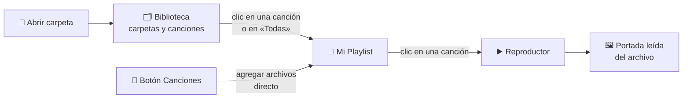

<div align="center">

# 🎵 MusicaLocal

### Tu música, tu navegador, tus reglas.

Un reproductor de música **100 % local** con playlist, biblioteca por carpetas y portadas a todo color.
Sin cuentas, sin servidores, sin subir nada a internet.


</div>

---

## 📸 Vista previa

La interfaz tiene tres paneles de cristal difuminado sobre el fondo que tú elijas:

```
┌──────────────────┐  ┌────────────────────────┐  ┌──────────────────┐
│ [Canciones][Fondo]│  │                        │  │ [ Abrir carpeta ]│
│                  │  │      ┌──────────┐      │  │                  │
│  Mi Playlist     │  │      │ PORTADA  │      │  │  Biblioteca      │
│  ───────────     │  │      └──────────┘      │  │  ┌─────┐ ┌─────┐ │
│  ▶ Canción 1   ✕ │  │       Título           │  │  │ 📁  │ │ 📁  │ │
│    Canción 2   ✕ │  │       Artista          │  │  │Rock │ │Pop  │ │
│    Canción 3   ✕ │  │  ●━━━━━━━━━━━━━━━━━━   │  │  └─────┘ └─────┘ │
│                  │  │  🔀  ◀   ▶   ▶  🔁     │  │                  │
└──────────────────┘  └────────────────────────┘  └──────────────────┘
      PLAYLIST               REPRODUCTOR               BIBLIOTECA
```

---

## ✨ Características

| | Qué hace |
|---|---|
| 🎧 **Reproductor completo** | Play/pausa, anterior, siguiente, aleatorio, repetir y barra de progreso con la que puedes saltar a cualquier parte de la canción. |
| 📁 **Biblioteca por carpetas** | Abre una carpeta de tu computador y cada subcarpeta aparece como una tarjeta con su número de canciones. |
| 📝 **Playlist a tu medida** | Elige canciones con un clic, agrégalas todas de una vez, quítalas con la ✕ o vacía la lista completa. |
| ✅ **Selección clara** | La canción que suena queda resaltada en la playlist, y la lista se desplaza sola para mostrarla. |
| 🖼️ **Portadas automáticas** | Lee la imagen incrustada en el archivo (tags ID3) y la muestra grande, con un brillo difuminado de fondo. |
| 🌄 **Fondo personalizable** | Cambia el fondo de toda la app con cualquier imagen de tu equipo. |
| 📱 **Responsive** | Tres columnas en pantallas grandes, dos en medianas y una sola en celular. |
| 🔒 **Privado** | Tus canciones nunca salen de tu navegador: no hay servidor ni subida de archivos. |

---

## 🧭 Cómo funciona



1. **Abres una carpeta** y la biblioteca agrupa tus audios por carpeta.
2. **Entras a una carpeta** y marcas las canciones que quieres; se agregan a tu playlist.
3. **Haces clic en una canción de la playlist** y empieza a sonar con su portada.

---

## 🚀 Cómo usarlo

### URL

Abre nuestra pagina oficial y disfruta de tú musica sin preocupacion: ...

### Ya dentro de la app

| Quiero... | Hago esto |
|---|---|
| Elegir música de una carpeta | **Abrir carpeta** → entro a una carpeta → clic en las canciones |
| Agregar toda una carpeta | Dentro de la carpeta, botón **Todas** |
| Agregar archivos sueltos | Botón **Canciones** (panel izquierdo) |
| Quitar una canción | La **✕** al lado de la canción en la playlist |
| Empezar de cero | Botón **Vaciar** en la playlist |
| Cambiar el fondo | Botón **Fondo** |
| Volver a las carpetas | La flecha **‹** arriba de la biblioteca |

> 💡 **Nota:** los iconos, la tipografía y el lector de portadas se cargan desde internet (CDN). La música es totalmente local, pero necesitas conexión la primera vez para que la interfaz se vea completa.

---

## 🗂️ Estructura del proyecto

```
MusicaLocal/
├── index.html      # Estructura: playlist, reproductor y biblioteca
├── styles.css      # Diseño: cristal, colores, tarjetas y responsive
├── script.js       # Lógica: reproducción, playlist, biblioteca y portadas
├── img/
│   ├── fondo.jpeg              # Fondo por defecto
│   └── file-earmark-music.svg  # Icono de la pestaña
└── docs/
    └── captura.png             # Captura para este README
```

---

## 🛠️ Tecnologías

- **HTML5, CSS3 y JavaScript** puros, sin frameworks.
- **[Bootstrap Icons](https://icons.getbootstrap.com/)** para los iconos de los controles.
- **[Audiowide](https://fonts.google.com/specimen/Audiowide)** (Google Fonts) como tipografía.
- **[jsmediatags](https://github.com/aadsm/jsmediatags)** para leer la portada incrustada en los archivos de audio.

### Detalles técnicos

- Los archivos se reproducen mediante `URL.createObjectURL`, así que **nunca se copian ni se suben**.
- La biblioteca usa el atributo `webkitdirectory` del input de archivos para abrir carpetas completas.
- La portada se convierte en un `Blob` y se usa también como brillo difuminado de fondo de la tarjeta.

---

## 🎨 Personalízalo

Todos los colores viven en variables al inicio de `styles.css`. Cambiando una sola línea cambia el color de todo el reproductor:

```css
:root {
    --acento: #ff4d5e;
}
```

---

## 🗺️ Ideas a futuro

- [ ] Leer título y artista desde los tags del archivo (hoy muestra «Desconocido»).
- [ ] Guardar la playlist para no perderla al recargar.
- [ ] Control de volumen y tiempo transcurrido en la barra.
- [ ] Atajos de teclado (espacio para play/pausa, flechas para cambiar).
- [ ] Varias playlists con nombre.

---

## 👨‍💻 Autores

<div align="center">

| **Johan Collazos** | **Esteban Villarreal** |
|:---:|:---:|
| Desarrollo y diseño | Desarrollo y diseño |

Hecho con lagrimas y mucha música.

</div>

---

<div align="center">

⭐ Si te gustó el proyecto, ¡déjale una estrella! ⭐

</div>

<div align="center">

**© Todos los derechos reservados**

</div>